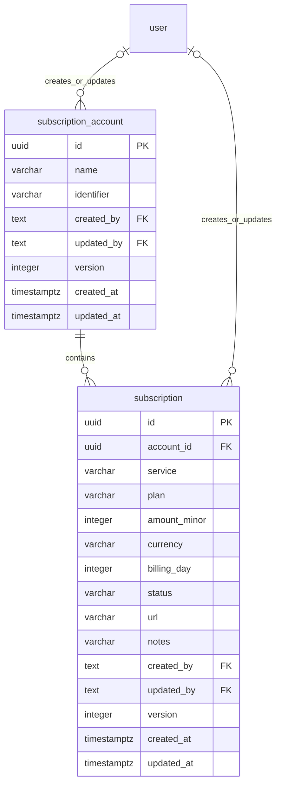

# Subscription — บริการรายเดือนและรายปีของบ้าน

รอบรายปีใช้ migration `007_subscription_yearly` เพิ่ม `billing_interval` (ค่าเดิมเป็น `monthly`) และ `billing_date` สำหรับวันที่อ้างอิงรอบต่ออายุ รายปีจะต่ออายุในวันและเดือนเดิม หากเป็น 29 ก.พ. ในปีปกติใช้ 28 ก.พ. และไม่แสดงรอบก่อนวันที่อ้างอิง

ฟอร์มเลือกรายเดือนหรือรายปีได้ ราคาที่บันทึกเป็นค่าบริการเต็มรอบ ยอดรวมและกราฟต่อเดือนเฉลี่ยราคารายปีด้วยการหาร 12 ส่วนประมาณการต่อปีรวมราคาเต็มรายปีและราคารายเดือนคูณ 12 เพื่อหลีกเลี่ยงความคลาดเคลื่อนจากการปัดเศษยอดเฉลี่ย

## หน้าจอและการใช้งาน

เปิด `/network/subscriptions` จากแท็บ Subscription ในหน้าเครือข่าย โดยแท็บอินเทอร์เน็ตเดิมยังอยู่ที่ `/network`

อ้างอิง `docs/design-system.html` และหน้า Network เดิม: พื้นงาช้าง/โหมดมืดตาม theme, หัวข้อ Trirong น้ำหนักเบา, เส้นบาง, การ์ด radius 8px และแท็บเส้นใต้ที่เลื่อนตามเมาส์ ใช้ปุ่มสูงอย่างน้อย 44px

- ด้านบน: ยอดรายเดือน, ประมาณการรายปี, จำนวนบริการที่ใช้งาน และรอบเรียกเก็บใน 7 วัน (วันนี้ถึงอีก 6 วัน)
- กราฟ treemap สีอ่อนตามภาพอ้างอิง: ขนาดแต่ละช่องคำนวณจากยอดเงินบาท บอกสัดส่วนและประมาณการรายปี กดบริการเพื่อแก้ไขได้ รายการศูนย์บาทยังอยู่ในรายการบัญชี แต่ไม่มีพื้นที่ในกราฟ
- ส่วนหลัก: ค้นหาชื่อบริการ/แพ็กเกจ/บัญชี/อีเมล กรองบัญชีและสถานะ รายการจัดกลุ่มตามบัญชีที่สมัครบริการ
- ด้านข้าง: รอบเรียกเก็บถัดไป 5 รายการ เรียงตามวันที่ บนมือถือย้ายลงใต้รายการ
- เพิ่มบัญชีก่อนเพิ่มบริการ บัญชีประกอบด้วยชื่อแสดงและอีเมลหรือชื่อผู้ใช้ ไม่ใช่บัญชีสำหรับล็อกอินเว็บ
- ฟอร์มเพิ่ม/แก้ไขเป็น native dialog รองรับคีย์บอร์ด การปิดด้วย Escape และ focus ภายใน dialog
- ฟอร์มหลักแสดงเว็บไซต์ (ไม่บังคับ), ชื่อบริการ, ราคา และสกุลเงินเท่านั้น ช่วยเติมชื่อจากโดเมนเมื่อช่องชื่อยังว่าง บัญชี/วันเรียกเก็บ/สถานะ/แพ็กเกจ/หมายเหตุอยู่ใน “รายละเอียดเพิ่มเติม” ที่พับไว้ แต่ยังส่งค่าครบเมื่อบันทึก
- บริการใหม่เลือกบัญชีจากการ์ดที่กด หรือบัญชีที่กรองอยู่ หรือบัญชีแรกตามลำดับ ตั้งวันเรียกเก็บเริ่มต้นเป็นวันที่ปัจจุบันในไทย และแสดงบัญชี/วันในแถวสรุปให้เห็นก่อนบันทึก รายการเดิมคงค่าที่เคยบันทึกไว้
- ไอคอนดึงตรงจาก `/favicon.ico` ของเว็บไซต์ที่กรอก แสดงตัวอย่างเมื่อออกจากช่องเว็บไซต์ และใช้ร่วมกันในรายการ/กราฟ/รอบเรียกเก็บ ใช้ `no-referrer` และ fallback เป็นตัวอักษรย่อเมื่อไม่มีไอคอน ไม่มี server-side fetch ไปยัง URL ที่ผู้ใช้กรอก
- สถานะบริการ: ใช้งานอยู่ / พักบริการ / ยกเลิกแล้ว เปิดใช้อีกครั้งได้ด้วยการแก้สถานะ
- ค่าเริ่มต้นแสดงเฉพาะรายการใช้งานอยู่ เปลี่ยนตัวกรองเป็นทุกสถานะเพื่อดูรายการที่พักหรือยกเลิก
- บัญชีแก้ชื่อ/อีเมลได้ บริการย้ายบัญชีได้ ไม่มีการลบถาวรในรุ่นนี้

ทุกผู้ใช้ที่ผ่าน session และ allowlist เดิมเห็นและแก้ไขข้อมูลร่วมกัน ไม่มีการกรองตามผู้เพิ่ม บันทึกผู้เพิ่มและผู้แก้ไขล่าสุดไว้กับข้อมูล ทุกการโหลดหน้า, กลับมา focus หน้าต่าง หรือกดรีเฟรช จะอ่านชุดข้อมูลกลางใหม่ ไม่ใช้ socket เพิ่ม

## แบบข้อมูล

ใช้ PostgreSQL ที่ระบุโดย `AUTH_DATABASE_URL` และ search path เดียวกับ migration runner เดิม แยกจากฐาน collector ไม่มี ENV ใหม่ และไม่ใช้ตาราง OAuth `account` เก็บ subscription

Migration: `src/db/migrations/006_subscriptions.ts`

- `subscription_account`: unique `(lower(name), lower(identifier))` ป้องกันบัญชีซ้ำ ไม่เปลี่ยนตัวพิมพ์ของชื่อผู้ใช้ที่จัดเก็บ
- `subscription`: FK `account_id` แบบ RESTRICT, index สำหรับจัดกลุ่ม, unique `(account_id, lower(service), lower(plan))` รวมสถานะที่ยกเลิกแล้ว เพื่อให้เปิดรายการเดิมกลับมาใช้ได้
- FK ผู้เพิ่ม/แก้ไขเป็น nullable และ SET NULL หากบัญชีล็อกอินถูกลบ รายการบริการยังอยู่
- `amount_minor` เก็บจำนวนสตางค์/เซนต์เป็น integer จากสตริงทศนิยม ไม่คำนวณค่าที่บันทึกด้วย floating point
- UI/API รับเฉพาะ THB และ USD (ทศนิยม 2 ตำแหน่ง) เก็บสกุลต้นทางไว้ และแสดงยอดบาทเป็นหลัก พร้อมยอด USD เดิมเป็นข้อมูลประกอบ ไม่แก้ migration 006 ที่ใช้ไปแล้วหรือแปลงทับข้อมูลที่บันทึก
- `version` เพิ่มทุกครั้งที่แก้ไข และใช้เป็นเงื่อนไข UPDATE แบบ optimistic concurrency

## กติกาคำนวณ

ทุกบริการเป็นรอบรายเดือน จำนวนเงินอยู่ในช่วง 0–1,000,000 ต่อเดือน ทศนิยมไม่เกิน 2 ตำแหน่ง ยอดรายเดือนรวมเฉพาะ `active` และประมาณการรายปี = ยอดรายเดือน × 12 ยอดรายบัญชีเป็นยอดทั้งหมดของบัญชีนั้น ไม่เปลี่ยนตามคำค้น

USD แปลงเป็นบาทด้วย `stash.gold.usd_buy` แถวล่าสุดตาม `updated_at` บน collector DB (`DATABASE_URL`) โดยคอลัมน์นี้มาจาก `exchange_buy` ของ YLG ใน `aide-collector/src/routes/stash/gold.js` อ้างอิงเพื่อประมาณการเท่านั้น ไม่ใช่เรทของบัตรเครดิต ใช้ index `uq_updated_at` แบบ backward scan + LIMIT 1 แสดงแหล่งที่มาและเวลาจาก DB บนหน้าจอ

เก็บเรทใน payload เป็น decimal string คูณจำนวนเซนต์ด้วย BigInt และปัดครึ่งขึ้นเป็นสตางค์ทีละรายการก่อนรวม ทำให้ยอดรวมตรงกับรายการที่แสดง ฟอร์ม USD แสดงตัวอย่างยอดบาททันที รองรับเว็บไซต์แบบ `youtube.com` โดยเติม `https://` เมื่อบันทึก

แคชเรทฝั่ง server 60 วินาที จำกัด query 5 วินาที ถ้าเรทขาดหาย ไม่เป็นบวก หรือ collector DB ใช้ไม่ได้ คืน `exchangeRate: null` โดยบริการยังอ่าน/แก้ไขได้ ยอด THB เดิมยังแสดง ส่วนยอดรวมที่มี USD แสดง “รอเรท” ไม่แสดงยอดรวมบางส่วนเป็นยอดเต็ม ไม่มีเรท hardcode ฝั่ง dashboard หากเรทเก่ากว่า 72 ชั่วโมงให้มีข้อความบอกอายุข้อมูล (collector ต้นทางมี fallback ของตัวเองซึ่งไม่ได้เก็บ flag แยกใน DB)

ใช้วันปัจจุบันใน Asia/Bangkok วันที่ 29–31 ในเดือนสั้นเลื่อนไปวันสุดท้ายของเดือน โดยเก็บ billing day เดิมไว้สำหรับเดือนถัดไป รายการที่เรียกเก็บวันนี้ยังอยู่ในรอบวันนี้

ระบบนี้เก็บค่าบริการและกำหนดเรียกเก็บ ไม่ได้ประมวลผลการชำระเงิน ไม่มีข้อมูลยอดชำระจริง/ยอดค้าง/ประวัติใบเสร็จ และไม่ยกเลิกบริการกับผู้ให้บริการโดยอัตโนมัติ

## API และการป้องกันข้อมูล

`/api/subscriptions` ใช้ session และ allowlist เดิมทุก method:

| Method | ข้อมูล | ผลลัพธ์ |
| --- | --- | --- |
| GET | — | `{ accounts, subscriptions, exchangeRate }` ชุดกลางพร้อมเรทอ้างอิง |
| POST | `kind: account` + name, identifier | สร้างบัญชี, 201 + id |
| POST | `kind: subscription` + accountId, service, plan, amount (string), currency, billingDay (number), status, url, notes | สร้างบริการ, 201 + id |
| PATCH | ข้อมูลเต็มเช่น POST + id, version | แก้ไขและเพิ่ม version, 200 + id |

ข้อมูลผิดตอบ 400, origin ไม่ตรงตอบ 403, ประเภทข้อมูลไม่ใช่ JSON ตอบ 415, รายการซ้ำ/ข้อมูลถูกแก้ไปแล้วตอบ 409, ฐานข้อมูลไม่พร้อมตอบ 503 โดยไม่ส่งรายละเอียดภายในออกไป ก่อนถึง route ผู้ที่ไม่ได้ล็อกอินจะถูก middleware ส่งไปหน้า login

ตรวจ origin สำหรับ POST/PATCH, ตรวจข้อมูลซ้ำทั้ง API และข้อกำหนดใน DB, รับ URL เฉพาะ http/https ที่ไม่มี credentials และไม่โหลด URL นั้นบนเซิร์ฟเวอร์ ใช้ parameterized queries และให้ Svelte escape เนื้อหาที่ผู้ใช้กรอก

ฟอร์มไม่ส่งซ้ำระหว่างกำลังบันทึก หากการเชื่อมต่อขาดระหว่างบันทึกให้รีเฟรชรายการก่อนลองใหม่ เมื่อพบ conflict ให้ปิดฟอร์ม รีเฟรช แล้วเปิดแก้ไขจาก version ล่าสุด

## ออฟไลน์และความผิดพลาด

อ่าน `docs/pwa-offline.md` ก่อนเปลี่ยน cache policy เพิ่มหน้านี้ใน WARM_URLS เพื่ออ่านสำเนา HTML ยามออฟไลน์ ใช้ `subscribeConnectivity()` ปิดการเพิ่ม/แก้ไขระหว่างออฟไลน์ ไม่มีคิวเขียนข้อมูลออฟไลน์

`/api/subscriptions` อยู่ใน BYPASS_PREFIXES เพื่อไม่ให้ข้อมูลสำหรับแก้ไข fallback ไปใช้ API cache เก่า เมื่อฐานข้อมูลอ่านไม่ได้ หน้าแสดงข้อผิดพลาดพร้อมรีเฟรชและตอบ HTTP 503 ไม่แสดงข้อมูลว่างราวกับไม่มีรายการจริง และไม่เขียนทับสำเนา HTML ที่เคยโหลดสำเร็จ

## การนำไปใช้

1. ตรวจ migration ที่ใช้แล้วก่อนรัน production ต้องถึง `005_relax_account_issuer` เพื่อไม่ให้คำสั่งรวมรันงาน auth ที่ไม่เกี่ยวข้องโดยไม่ตั้งใจ
2. รัน `bun run migration:run` เพื่อเพิ่มเฉพาะ `006_subscriptions` บนฐานเป้าหมาย จากนั้น `bun run build` และ restart เว็บตามวิธี deploy เดิม
3. เปิด Network → Subscription, เพิ่มบัญชีจริงและรายการจริง ไม่มี seed ข้อมูลตัวอย่างลงฐานบ้าน
4. Rollback application ได้โดยเก็บตารางใหม่ไว้ หากเรียก `down()` จะลบข้อมูล subscription ทั้งหมด จึงต้องสำรองและอนุมัติการลบก่อนเสมอ

ตรวจ migration ทั้งชุดและการทำงานกับ PostgreSQL 16 ชั่วคราว: อ่าน/เขียนจริง, บัญชีล็อกอินสองคนเห็นชุดเดียวกัน, unique/FK, optimistic conflict, validation, CSRF, เงินทศนิยม, ก.พ./leap year/ข้ามปี และ SSR HTTP ใช้การตรวจแบบครั้งเดียว ไม่มีการเพิ่มหรือแก้ test scripts
